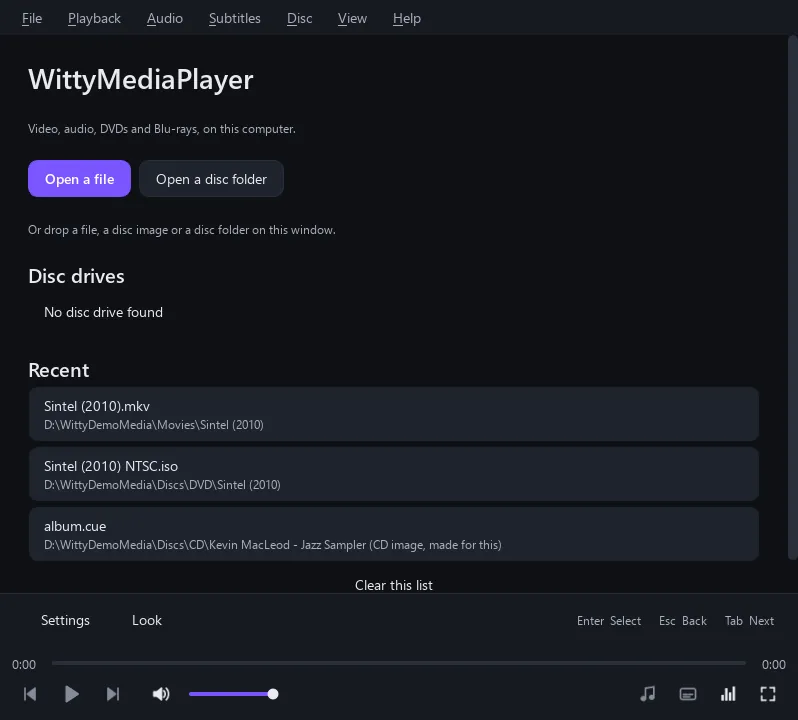
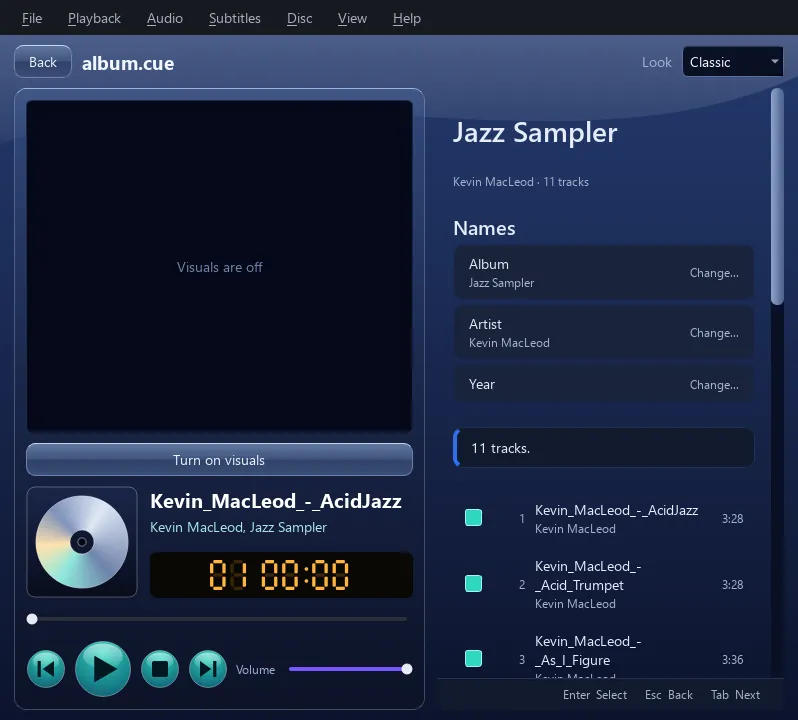
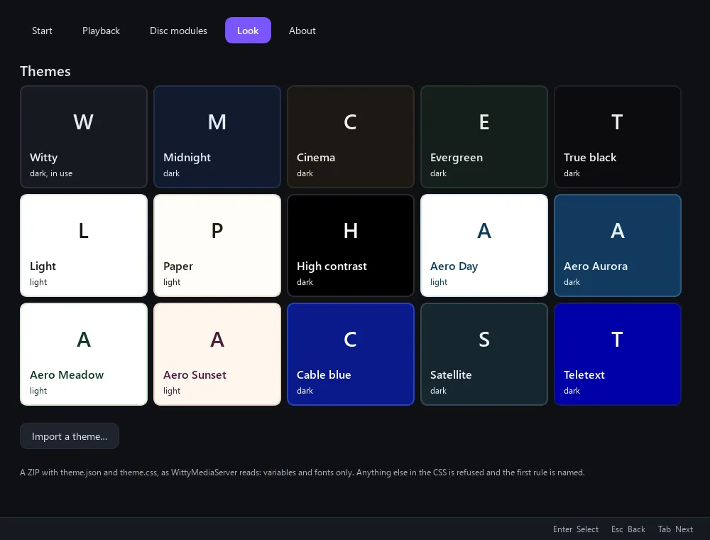
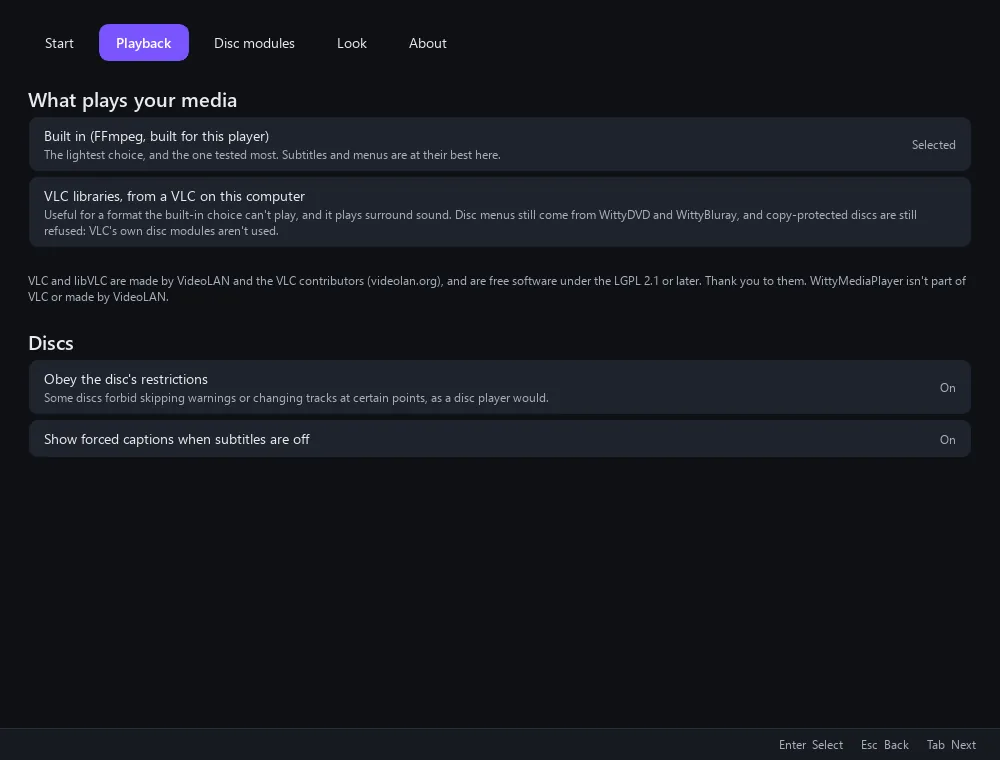

<p align="center">
  
</p>

# WittyMediaPlayer

A desktop player for video, audio, DVDs and Blu-rays on your own computer, with real disc menus. It works straight from a drive, a disc image or a folder, with no server and no account. You need it if you want to play discs and files on a PC.

It's a standalone Qt app, not a module: it needs no [WittyMediaServer](https://github.com/wittywilla/WittyMediaServer), and shares that project's disc engines, themes and look ([wittymediaserver.com](https://wittymediaserver.com)). It's under the GNU GPL v3.0 or later.

<p align="center">
  
  
</p>
<p align="center">
  
  
</p>

<sub>WittyMediaPlayer 0.1.3 on Windows. The CD is an image of [Jazz Sampler](https://archive.org/details/Jazz_Sampler-9619), Kevin MacLeod, [CC BY 3.0](https://creativecommons.org/licenses/by/3.0/); the recent files are from [Sintel](https://durian.blender.org/), Blender Foundation, [CC BY 3.0](https://creativecommons.org/licenses/by/3.0/).</sub>

## What it does

- **Plays ordinary files:** MKV, MP4, AVI, MPEG, TS, WebM, WMV, MP3, AAC, FLAC, Ogg, WAV and more, with audio and
  subtitle track choice. Subtitle files beside a video (`Movie.srt`, `Movie.en.srt`) are found by themselves.
- **Plays DVDs and Blu-rays with their real menus,** from a drive, `.iso` and `.img` images, or `VIDEO_TS` and `BDMV`
  folders: arrows, Enter and the mouse work the disc's own buttons, with title, chapter and angle controls, using the
  same engines as WittyMediaServer.
- **Finds the film on a disc that hides it** among decoy titles, or cut into pieces, from the disc's index alone.
  **Disc, Why this title** says how sure it is and why; a film's other cuts and a TV disc's episodes are in the **Disc** menu.
- **Makes disc images:** copies a disc to one `.iso` or `.img` file to keep, play later, or add to a WittyMediaServer library.
- **Plays and copies audio CDs,** from a drive or an image (`.cue`, `.toc`, `.ccd`, `.nrg`, `.chd`, `.bin`): tick the
  tracks and copy them to FLAC, ALAC, WAV, MP3, AAC, Opus or Ogg Vorbis, with careful reading, tags and cover art, or
  make a `.cue` and `.bin` image of the disc.
- **Shows music as light:** [WittyVisualizer](https://github.com/wittywilla/WittyVisualizer) brings seventeen effects
  to audio files, full screen, with a flash limiter and a calm mode. It's off until you turn it on (V).
- **Says no plainly:** a copy-protected disc gets a clear message. Nothing here unlocks copy protection.
- **Runs well on small machines:** the picture is drawn by the graphics card, and hardware decoding is used where the card has it.
- **Can use the VLC libraries:** if you have [VLC](https://www.videolan.org/vlc/) installed, **File, Settings** can play
  through its libraries instead of the built-in FFmpeg, for formats the built-in choice can't play, and for surround
  sound. They aren't included here and aren't needed.
- **Updates its disc modules one at a time:** WittyDVD and WittyBluray can each take a newer signed version without a new
  player, from **File, Settings**. A version that keeps failing is taken back out by itself, and the built-in copy always works.
- **Keeps to itself:** no telemetry, and nothing leaves your computer unless you press a button that says so. **Look for
  updates** talks only to GitHub. **Look up names** on the CD screen sends only the disc's track layout to MusicBrainz,
  and fetches its cover from the Cover Art Archive. Its FFmpeg and its disc helper are built with no network code, and
  only a small updater program has any. (`Qt6Network.dll` is in the folder only because Qt's sound library won't load
  without it. Nothing calls it.)

It doesn't do these yet:

- Blu-ray menus written in Java don't run. The disc plays its titles instead, and the window says so.
- Sound is stereo with the built-in playback. Surround tracks are mixed down.
- Packages are for Windows, and an AppImage for Linux that hasn't been tried on Linux yet. None for macOS. Nothing in
  the design stops other systems: see [DESIGN.md](DESIGN.md).

## How it looks

Every screen that isn't playback (the start page, Settings, Disc modules, Look, a disc's guide and health, WittyRemote) is
a page of [WittyMediaServer's server-driven UI](https://github.com/wittywilla/WittyMediaServer/blob/master/docs/SDUI.md),
made on your computer by the player's own helper and drawn by the player. The themes are WittyMediaServer's fifteen, and
**View, Look** imports your own (a ZIP of `theme.json` and `theme.css`, as
[its THEMES guide](https://github.com/wittywilla/WittyMediaServer/blob/master/docs/THEMES.md) says). Aero's gloss and
glass, and the Satellite theme's bevel, are drawn too; **Flat** turns them off. [DESIGN.md](DESIGN.md) says how.

## What it needs, and where it runs

- Windows 10 version 1809 or newer, 64-bit, or 64-bit Linux for the AppImage (not tried yet: see the table).
- VLC, only if you choose to play through its libraries.
- A disc drive, only to play or copy from one.

It's built on Qt and FFmpeg, which come with it, and on WittyDVD, WittyBluray, WittyCD, WittyDisc and WittyModule, built
in. WittyVisualizer's effects are built in too.

| System | Where it stands |
|---|---|
| Windows 10 and later, 64-bit | Built and run from a real Windows machine, with no disc drive attached. The installer has been checked under Wine in a throwaway container and has not been run on real Windows. No real disc has been played from a drive |
| Linux, 64-bit (x86_64, aarch64) | An AppImage, from `scripts/build-linux.sh`. Written and checked on a Mac only: the helpers build for Linux and the package check runs against a stand-in, but the AppImage itself has never been built or run. Plays files, images and folders; audio CDs from a drive are written for Windows only. Decoding is in software (no VA-API yet) |
| macOS, FreeBSD | No package. The window and its tests build and run on a Mac for development. [DESIGN.md](DESIGN.md) lists what a port needs |

## How to get it

Download **`WittyMediaPlayer-<version>-windows-amd64.msi`** from
[Releases](https://github.com/wittywilla/WittyMediaPlayer/releases) and open it. The installer asks three things:

- **Who it's for.** Just you, which needs no administrator, or everyone on this computer, which goes in Program Files.
- **A shortcut on the desktop,** if you want one. It's always in the Start menu.
- **Which kinds of file to list it for,** under Open with: video, music and disc images. Whatever opens those files now
  still opens them, until you choose WittyMediaPlayer in Windows Settings, under Apps, Default apps.

Windows may say it protected your PC from an unrecognised app, because the installer isn't signed yet. Choose **More
info**, then **Run anyway**. A newer installer upgrades the one you have, keeping your settings and your answers.

**Without installing:** **`WittyMediaPlayer-<version>-windows-amd64.zip`** is the same program as a folder. Unzip it
anywhere and run `WittyMediaPlayer.exe`. Its settings are in the same place as an installed copy's.

### For administrators

```bash
msiexec /i WittyMediaPlayer-<version>-windows-amd64.msi /qn MSIINSTALLPERUSER=1
```

```bash
msiexec /i WittyMediaPlayer-<version>-windows-amd64.msi /qn MSIINSTALLPERUSER="" DESKTOPSHORTCUT=1 ASSOCDISC=0
```

| Property | Means | If you don't say |
|---|---|---|
| `MSIINSTALLPERUSER` | `1` just for this account; `""` for everyone (run it as an administrator) | just for this account |
| `DESKTOPSHORTCUT` | `1` puts a shortcut on the desktop | none |
| `ASSOCVIDEO`, `ASSOCMUSIC`, `ASSOCDISC` | `0` leaves that kind of file off the Open with list | listed |

An upgrade keeps the last answers to these, whatever a new command line says.

### Removing it

Use **Settings, Apps, Installed apps** and choose WittyMediaPlayer (a portable copy has the same
`Uninstall WittyMediaPlayer.exe` in its folder). It says what it's about to do, closes the player if it's open, and asks
one question: whether to also delete your settings and the disc modules it downloaded. Then it lists what it removed and
anything it couldn't, and keeps that list in your temp folder.

| It removes | Where |
|---|---|
| The program | `%LOCALAPPDATA%\Programs\WittyMediaPlayer`, `C:\Program Files\WittyMediaPlayer` or the folder you unzipped: only the files in its `package-files.txt` |
| Shortcuts | The Start menu and the desktop |
| Its registry entries | Installed apps, Default apps, Open with, its file types, its own key, and what File Explorer noted about it (the place in Open with lists, a default you chose, its name) |
| If you say yes: your settings | `%APPDATA%\WittyMediaPlayer` |
| If you say yes: downloaded modules | `%LOCALAPPDATA%\WittyMediaPlayer\modules` |

The player keeps no logs and no caches of its own. Your media, the CDs you copied, the disc images you made and any file
the player didn't make are left alone and listed. As an administrator it also clears other accounts' settings and
shortcuts, but not what File Explorer noted in their registries. Windows' own history of recent files isn't touched.

For scripts:

```bash
"Uninstall WittyMediaPlayer.exe" /S
```

```bash
"Uninstall WittyMediaPlayer.exe" /S /RemoveData --report C:\Temp\removed.txt
```

```bash
"Uninstall WittyMediaPlayer.exe" --dry-run
```

`/S` asks nothing and keeps your settings; `/RemoveData` is a full clean-up. It returns at once and works in the
background, and the file named by `--report` appears when it has finished. `msiexec /x` also works, and keeps your settings.

## How to use it

Open something with **File, Open**, by dropping it on the window, from the list of drives on the start page, from a
file's **Open with** menu, or from a command line:

```bash
WittyMediaPlayer.exe "C:\Movies\film.mkv"
```

```bash
WittyMediaPlayer.exe "C:\Discs\film.iso"
```

```bash
WittyMediaPlayer.exe D:
```

| Program in the folder | What it's for |
|---|---|
| `WittyMediaPlayer.exe` | The player. This is the one you open |
| `Uninstall WittyMediaPlayer.exe` | Removes it |
| `bin\wittymediaplayer-engine.exe` | Reads discs for the player, and makes disc images from a command line. No network code |
| `bin\wittymediaplayer-updater.exe` | Downloads updates to the disc modules and looks up CD names, only when you press a button that says so |

The rest are the libraries the player is built on, which Windows needs beside it. `licenses\` says what they are and
where their source is.

### Keyboard

| Key | Does |
|---|---|
| Space or K | Play or pause |
| Left, Right | Back and forward 10 seconds |
| Up, Down | Volume |
| F, Esc | Full screen, and out of it |
| A, S | Next audio track, next subtitle track |
| N, P | Next and previous chapter |
| 1 to 9 | Go to that chapter on a disc; that far through a file |
| M (files) | Mute |
| V | The visualizer, for music |

While the visualizer is on the whole screen or has the focus, Left and Right change the effect, R is random order, S a
favourite, and + and - its strength.

In a disc's menus, the arrow keys and Enter move along its buttons and press one, M is the disc's menu (or its pop-up
menu during a Blu-ray film), T the title menu, and Backspace goes back up a menu. Tab reaches every control, and screen
readers can read them, including a disc's menu buttons.

### Choosing what to watch on a disc

A disc's own menu is still the first way to choose. The **Disc** menu adds what the disc engines found by reading the
disc's index:

| In the Disc menu | What it does |
|---|---|
| **Play main feature** | Plays the film, and says which title that is and how long. A film the disc cuts into several titles plays as one, with one seek bar, in the disc's own order |
| **Why this title…** (**Why this playlist…** on a Blu-ray) | Says why that title was picked, how sure the pick is, what else was noticed (decoy titles, a film in several titles, places where the disc's index was mended) and how many sectors of the disc couldn't be read so far |
| **Play title N as the main feature from now on** | Shown while a title plays that isn't the film. Makes it the one **Play main feature** plays on this disc |
| **Forget your main feature for this disc** | Shown when you chose one. **Play main feature** goes back to the engine's pick |
| **Titles** | The titles worth choosing, each with what it is. Decoys are one level down, under **More titles** |
| **Versions** (DVD) or **Editions** (Blu-ray) | A film's other cuts, camera angles and the cuts a parental level chooses. The one you choose becomes this disc's main feature |
| **Episodes** | A TV disc's episodes in viewing order, with **Play all** first |

Your main feature for a disc is kept in your settings, on this computer only, under a fingerprint worked out from its
titles' lengths and chapters (the same for the disc, its image and a folder copy). Nothing else about the disc is kept.
None of this unlocks anything: it comes from the parts of a disc that are never scrambled, and a copy-protected disc is
still refused. The Blu-ray engine's optional comparison with a `libbluray` of your own isn't used by the player.

### Making a disc image

Put the disc in a drive, then choose **File, Make disc image** or the button beside the drive on the start page. To use
the image in WittyMediaServer, save it in (or move it to) a folder one of your disc libraries watches, and scan the
library. The same copy runs from a command line, and never overwrites anything:

```bash
bin\wittymediaplayer-engine.exe --image D: "C:\Discs\film.iso"
```

Discs protected with CSS or AACS are refused before anything is written. Audio CDs are imaged from the CD screen.

### Audio CDs

Open a CD from the start page or **File, Play from drive**, or open an image of one. The CD screen shows the tracks with
a tick beside each, and waits for you to press play. Space or K plays or pauses, N and P go to the next and previous
track, S stops, Left and Right go back and forward 10 seconds, and Up and Down change the volume. Enter on a track plays
it and F2 changes its name. V turns the visuals on, then the next simple style, and E switches between the simple
visualizer and WittyVisualizer's effects.

**Copying:** tick the tracks, choose a format, a quality and a folder, then press **Copy ticked tracks**. A file takes
its real name only when it's finished, so a stopped copy leaves nothing behind, and nothing is overwritten: a second
copy gets `(2)` in its name. A report in the same folder gives each track's checksum and how its reading went.

**Names:** the box takes `{albumartist}`, `{artist}`, `{album}`, `{title}`, `{track}`, `{tracks}`, `{disc}` and `{year}`,
and a slash makes a folder. The default is `{albumartist}/{album}/{track} {title}`.

**Careful reading:** with **Check every read twice** on, each track is read until two reads match. A spot that never
reads becomes silence, and the row and the report say how much. **Drive offset** corrects a drive that reads a few
samples early or late; leave it at 0 unless you know your drive's figure. An image needs neither. A disc that can't be
read the ordinary way gets a plain message: there's no way around copy protection on a CD either.

**The look and the visuals:** the box at the top right switches between the Classic look and your app theme. The
visuals are off until you turn them on, and the first time you're told about flashing light and can choose calm mode.
Bars, Scope, Rings and Plasma run on the processor, anywhere; **More effects** brings in WittyVisualizer's seventeen,
drawn by your graphics card. Everything goes through a flash limiter that no style can get around.

## Building and testing

You need Git for Windows, Python 3 and Go, and a clone of [WittyVisualizer](https://github.com/wittywilla/WittyVisualizer)
beside this one (or `WITTYVISUALIZER_DIR` set to one, in a worktree). Everything else is fetched for your user only,
with no administrator rights and no accounts. Run these in Git Bash from the repository's top folder. The first takes
about ten minutes and 4 GB:

```bash
bash scripts/setup-toolchain.sh
```

```bash
bash scripts/build-windows.sh
```

The portable folder and zip land in `.build/`. The installer is made from that folder, with the
[WiX Toolset](https://wixtoolset.org) 6 on the `PATH` or at `WIX_EXE` (the top of the script says how to get it). Run
this in PowerShell, with the version from `CMakeLists.txt`:

```powershell
packaging\windows\build-msi.ps1 -Version <version> -PackageDir .build\WittyMediaPlayer-<version>-windows-amd64 -OutDir .build
```

To run the tests:

```bash
bash scripts/test.sh
```

They need no one at the screen and use Qt's offscreen platform. `WITTY_TEST_DVD` and `WITTY_TEST_BD` add real disc
images, which are only ever read. The disc engines' synthetic discs (a film among decoys, a film cut into titles, TV
discs, a film with two cuts) are played too: the engine's tests write them when WittyDVD and WittyBluray are cloned
beside this repository, and the window's tests play them when `WITTY_TEST_SYNTH_DVD` and `WITTY_TEST_SYNTH_BD` name the
folders those engines' `TestExportSyntheticDiscs` wrote. CI only tests `engine/`, because the whole player needs the
toolchain above.

To test the installer, neither of these installs anything on the computer you run it on:

- `scripts\test\check-msi.ps1` reads the MSI's tables and unpacks it to a folder of your choosing, to check what's in it.
- `scripts/test/installers-wine.sh` really installs, upgrades and removes it, for one person and for everyone, in a
  throwaway Docker container with Wine, and compares every file and registry entry from before and after.

`engine/internal/uninstall` has tests that read the player's source and the installer's: they fail if the player starts
writing somewhere the uninstaller doesn't know, or the installer writes something it wouldn't remove.

`scripts/check-package.sh` stops the build if a package carries or loads a disc-decryption library or a key database.

### On Linux

On a 64-bit Linux machine with the compilers and libraries the top of `scripts/setup-toolchain-linux.sh` lists, and a
clone of WittyVisualizer beside this one, run these from the repository's top folder. The first fetches Qt and builds
the same network-free FFmpeg as the Windows build (`scripts/ffmpeg-components.sh`), for your user only:

```bash
bash scripts/setup-toolchain-linux.sh
```

```bash
bash scripts/build-linux.sh
```

The AppImage lands in `.build/linux/`, with FFmpeg's source beside it. `scripts/check-package-linux.sh` checks the
folder it is made from by the same rules as the Windows package, and the AppImage tools are exactly the files
`packaging/linux/tools.lock` names. The image carries its own Qt and FFmpeg; X11 or Wayland, OpenGL and PulseAudio or
PipeWire come from the computer. Modules updated from **File, Settings** go into `~/.cache/WittyMediaPlayer/modules`,
since nothing can change a file inside the image.

### Trying a real CD

This was built on a laptop with no disc drive, so a real disc is yours to try:

1. Put in a music CD: its row on the start page should say **audio CD**. Press **Open CD**.
2. The tracks should have the right lengths. Play, then try next, previous and seeking.
3. **Look up names** should fill in album, artist, tracks and cover, or say MusicBrainz doesn't know the disc.
4. Copy two short tracks to FLAC: both should finish as "Done, checked". Play them, and read the report beside them.
5. Do the same with MP3, and check the tags and cover in another program.
6. **Make image**, then open the `.cue` it wrote: same tracks, same sound.
7. **Stop copying** part way through a copy: the unfinished file should be gone.
8. A scratched disc's row should say how many sectors were bad, rather than stopping or hiding it.
9. Take the disc out while it plays: it should say so.

### Its icon

The icon (the family's ring with a play button inside and a sky-blue dot) and the Windows installer's pictures are
drawn by WittyMediaServer's `scripts/genicon`, the one generator for every logo of the family (its `docs/BRAND.md`).
Run `scripts/sync-brand.sh` with a WittyMediaServer checkout beside this one to redraw them, or with `--check` to see
whether they are up to date. Never edit `resources/WittyMediaPlayer.ico`, `resources/icon.svg`, `resources/icon-256.png`
or `resources/windows/*.bmp` by hand.

## Licence

GNU GPL v3.0 (or later): see [LICENSE](LICENSE) and [NOTICE](NOTICE). If you redistribute it or build on it, please keep
the NOTICE attribution. The Witty disc libraries it is built from are under the GNU AGPL v3.0 (or later), as
WittyMediaServer is.

Qt and FFmpeg ship as separate libraries under the LGPL, so you can replace them. LAME, Opus, Vorbis and Ogg are inside
FFmpeg's libraries, and zlib and the GCC and mingw-w64 runtimes ship beside them.
[licenses/THIRD-PARTY.txt](licenses/THIRD-PARTY.txt) has each one's licence and source.

- **[Qt](https://www.qt.io)**, by The Qt Company and contributors, for the window.
- **[FFmpeg](https://ffmpeg.org)**, by the FFmpeg developers, for built-in decoding.
- **WittyDVD**, **WittyBluray**, **WittyCD**, **WittyDisc** and **WittyModule**, by WittyWilla, for discs.
- If you ask, CD names come from [MusicBrainz](https://musicbrainz.org) and covers from the [Cover Art Archive](https://coverartarchive.org).

## Legal

WittyMediaPlayer is an independent open-source project. It isn't associated with, sponsored by or
endorsed by the owners of the DVD, Blu-ray or Compact Disc formats, any studio or label, or any other
player project. Your files and what you open are yours: the WittyMediaServer project doesn't provide,
host, own or check them. No media comes with it, encrypted discs are refused, nothing is decrypted,
and you're responsible for having the rights to what you open or rip. CD names and covers it looks
up when you ask come from third-party services on the web, and aren't created by, associated with,
endorsed by or checked by the WittyMediaServer project, its contributors or affiliates.

The optional playback libraries it can use, [VLC and libVLC](https://www.videolan.org/vlc/libvlc.html),
are by VideoLAN and the VLC contributors, under the LGPL 2.1 or later. WittyMediaPlayer loads them
from your own VLC when you choose them in Settings, and doesn't ship them. It isn't part of VLC or
made by VideoLAN. Thank you to them for making these libraries.

Any third-party names here only describe what it works with, and belong to their owners. It's
provided “as is”, with no warranty; see [LICENSE](LICENSE). Local law applies to how you use it.
This isn't legal advice.
